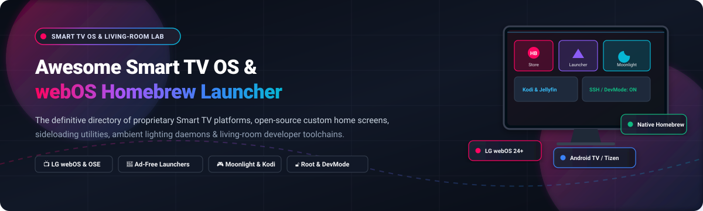
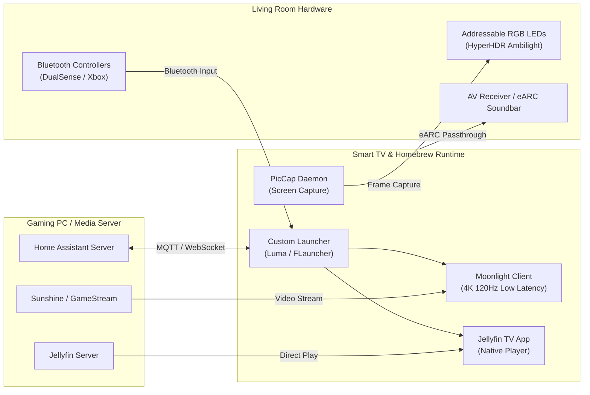

<p align="center">
  
</p>

# 📺 Awesome Smart TV OS & webOS Homebrew Launcher 🚀

<p align="center">
  <a href="https://github.com/ishandutta2007/Awesome-Awesome-Awesome"></a>
  <a href="https://discord.gg/jc4xtF58Ve"></a>
  <a href="https://github.com/ishandutta2007/Awesome-Smart-TV-OS-Webos-Homebrew-Launcher/stargazers"></a>
  <a href="https://github.com/ishandutta2007/Awesome-Smart-TV-OS-Webos-Homebrew-Launcher/network/members"></a>
  <a href="https://github.com/ishandutta2007/Awesome-Smart-TV-OS-Webos-Homebrew-Launcher/issues"></a>
  <a href="https://github.com/ishandutta2007/Awesome-Smart-TV-OS-Webos-Homebrew-Launcher/blob/main/LICENSE"></a>
  <a href="https://github.com/ishandutta2007"></a>
</p>

---

## 🌟 Overview & Highlights

A curated directory and developer guide to **proprietary Smart TV OS platforms**, **living-room developer clouds**, and **open-source GitHub homebrew launchers**. 

Whether you want to escape sponsored clutter on your television, sideload unsigned `.ipk` / `.apk` packages, cross-compile native Rust and C++ OpenGL ES frontends, configure ambient backlighting with PicCap/HyperHDR, stream 4K 120 FPS PC games via Moonlight, or build custom television operating system images, this list aggregates the best production tools and community firmware mods.

---

## 📑 Table of Contents
- [📊 Sector Overview & Market Dynamics](#-sector-overview--market-dynamics)
- [🏢 SaaS & Hosted Smart TV Platforms](#-saas--hosted-smart-tv-platforms)
- [💻 Open-Source GitHub Projects](#-open-source-github-projects)
  - [Top Open-Source TV Projects by Community Adoption](#top-open-source-tv-projects-by-community-adoption)
  - [Featured webOS Homebrew Ecosystem](#featured-webos-homebrew-ecosystem)
- [🛠️ Living-Room Architecture Blueprints](#️-living-room-architecture-blueprints)
- [🤝 How to Contribute](#-how-to-contribute)
- [💖 Support & Sponsorship](#-support--sponsorship)
- [📈 Star History](#--star-history)
- [⚠️ Disclaimer](#️-disclaimer)

---

## 📊 Sector Overview & Market Dynamics

The global **Smart TV OS, Connected TV (CTV), and Streaming Platform market** is valued at approximately **$215 Billion in 2026** and projected to reach **$380+ Billion by 2032** (expanding at an 8.5% CAGR). 

The sector is **moderately concentrated among a handful of tech giants and major display OEMs** (Google/Android TV, Apple tvOS, Roku OS, Samsung Tizen, and LG webOS account for over 75% of active global living-room screens), but exhibits **niche fragmentation at the tier-2 OEM layer** through independent white-label operating systems (such as Whale TV, Foxxum, and VIDAA) alongside a thriving **enthusiast open-source homebrew ecosystem** dedicated to user sovereignty, telemetry removal, and ad-free interfaces.

---

## 🏢 SaaS & Hosted Smart TV Platforms

The table below lists leading commercial Smart TV developer portals, cloud distribution ecosystems, and OEM consoles, **sorted in descending order by company scale (market capitalization / parent valuation)**.

| Platform / Console | Organization | Scale (Market Cap / Valuation) | Developer Starting Pricing | Free Tier / Trial Limits | Key Capabilities |
| :--- | :--- | :--- | :--- | :--- | :--- |
| **[Apple tvOS Developer](https://developer.apple.com/tvos/)** | Apple Inc. | **~$3,500B** (Market Cap) | **$99/year** (Apple Developer Program starting tier) | **Free Apple ID mode**: Xcode on-device testing limited to 3 personal sideloaded apps valid for 7 days per signing session. | SwiftUI / TVUIKit, Metal 4K HDR graphics rendering, TestFlight beta distribution, and App Store in-app purchases. |
| **[Android TV & Google TV Developer Portal](https://developer.android.com/tv)** | Google (Alphabet Inc.) | **~$2,150B** (Market Cap) | **$25 one-time registration fee** (Google Play Console) | **Free forever**: Unlimited local ADB sideloading and internal app sharing for up to 100 test accounts without payment. | Leanback UI toolkit, Google Cast receiver runtime, MediaSession APIs, and worldwide Google Play Store distribution. |
| **[Amazon Fire TV Developer Portal](https://developer.amazon.com/fire-tv)** | Amazon.com, Inc. | **~$2,100B** (Market Cap) | **$0/year** (Free developer account; 30% standard revenue share on paid digital sales) | **Free forever**: Full access to Fire TV SDK, Live App Testing (LAT) for 500 testers, and Appstore publishing with no annual subscription fee. | Android Fire OS & Vega OS runtimes, Alexa Voice Services (AVS) integration, in-app purchasing, and unified catalog search. |
| **[Samsung Tizen Studio & TV Seller Office](https://developer.samsung.com/smarttv)** | Samsung Electronics | **~$360B** (Market Cap) | **$0/year** (Free TV Seller account; standard 30% digital goods revenue share) | **Free forever**: Full unrestricted access to Tizen Studio SDK, TV emulators, on-device developer certificates, and global store submission. | WebAssembly & .NET C# TV runtime, Samsung Checkout billing, Knox security framework, and SmartThings IoT bridging. |
| **[LG webOS Developer & Seller Lounge](https://webostv.developer.lge.com/)** | LG Electronics | **~$12B** (Market Cap) | **$0/year** (Free Developer / Seller Lounge account; standard 30% store transaction rev-share) | **Free Developer Mode session**: Dev Mode app on LG Content Store provides free shell access renewed in **50-hour increments** (or automatable via CLI). | webOS Enact UI framework, Luna Service Bus APIs, native C/C++ cross-compilers, and LG Content Store global publishing. |
| **[Roku Developer Cloud & Channel Store](https://developer.roku.com/)** | Roku, Inc. | **~$11B** (Market Cap) | **$0/year** (Free Roku Developer account; 20%–30% digital store commission) | **Free forever**: Local developer hardware mode sideloading for 1 active channel packaging at a time; unlimited private channel testing. | BrightScript and SceneGraph UI frameworks, Roku Pay billing engine, Audience Network ads, and automated Channel Store certification. |
| **[VIDAA Smart OS Developer Portal](https://developer.vidaa.com/)** | VIDAA / Hisense | **~$6B** (Parent Hisense Group) | **$0/year** (Free developer registration; customized commercial terms for tier-1 OEM preloads) | **Free forever**: Free developer portal signup, documentation, web-app simulator, and manual TV debug IP sideloading without license fees. | HTML5 / WebGL living-room application engine, lightweight Linux runtime optimized for budget SoC TVs, and pre-integrated CTV ad monetization. |
| **[Whale TV (Zeasn Whale OS)](https://www.whaletv.com/)** | Whale TV / Zeasn | **~$300M** (Estimated Enterprise Value) | **$0/year** (Free developer account; enterprise revenue-share / ad-split model) | **Free forever**: Free documentation, web app validator, and cloud developer portal access for testing OEM HTML5 app packages. | Turnkey Connected TV OS, Whale TV turnkey app store, FAST channel aggregation, and dynamic recommendation engine for global TV OEMs. |
| **[Foxxum OS & CTV Cloud](https://foxxum.com/)** | Foxxum GmbH | **~$50M** (Estimated Valuation) | **$0/year** (Free partner registration; customized revenue-share on app distribution & ad inventory) | **Free forever**: Free developer SDK access, HTML5 compliance test suite, and direct remote sideloading assistance on Foxxum-powered TV models. | White-label CTV portal, custom launcher skins for TV brands, global CTV monetization network, and unified live TV / VOD guide. |

---

## 💻 Open-Source GitHub Projects

Explore verified open-source projects for Smart TV operating systems, custom home launchers, sideloading tools, and living-room media runtimes.

### Top Open-Source TV Projects by Community Adoption

Repositories are sorted below in **descending order by GitHub star count**. Each badge displays live star counts and directly links to the project's stargazers.

| Project & Repository | GitHub Stars (Live Badge) | Primary Stack | Core Description |
| :--- | :---: | :--- | :--- |
| **[Home Assistant Core](https://github.com/home-assistant/core)** | [](https://github.com/home-assistant/core/stargazers) | Python | Open-source home automation system providing deep bidirectional control, power states, app launcher integrations, and media display widgets for LG webOS, Tizen, Android TV, and Apple TV. |
| **[Jellyfin Server](https://github.com/jellyfin/jellyfin)** | [](https://github.com/jellyfin/jellyfin/stargazers) | C# / .NET | The 100% free software media system backend that serves 4K HDR movies, TV shows, and music directly to custom Smart TV clients without tracking or licensing fees. |
| **[SmartTube](https://github.com/yuliskov/SmartTube)** | [](https://github.com/yuliskov/SmartTube/stargazers) | Java / Kotlin | Advanced open-source YouTube client engineered for Android TV and Google TV featuring built-in SponsorBlock, ad-blocking, background playback, and up to 8K HDR 60fps AV1 playback. |
| **[Kodi Media Center](https://github.com/xbmc/xbmc)** | [](https://github.com/xbmc/xbmc/stargazers) | C++ | The gold-standard 10-foot living-room media center, launcher, and entertainment hub supporting custom skins, PVR TV tuners, retro gaming emulators, and Python extensions. |
| **[VLC Media Player](https://github.com/videolan/vlc)** | [](https://github.com/videolan/vlc/stargazers) | C / C++ | Highly optimized cross-platform media player and streaming engine compiled across desktop and living-room TV architectures with universal codec support. |
| **[Moonlight Qt](https://github.com/moonlight-stream/moonlight-qt)** | [](https://github.com/moonlight-stream/moonlight-qt/stargazers) | C++ / Qt | Ultra-low latency game streaming client for Sunshine / NVIDIA GameStream, streaming 4K HDR up to 120 FPS games directly from PC to living-room hardware. |
| **[RetroArch](https://github.com/libretro/RetroArch)** | [](https://github.com/libretro/RetroArch/stargazers) | C / C++ | Modular multi-system emulator frontend powering console gaming across Smart TVs, handhelds, and living-room single-board computers with shader support. |
| **[Jellyfin Android TV](https://github.com/jellyfin/jellyfin-androidtv)** | [](https://github.com/jellyfin/jellyfin-androidtv/stargazers) | Kotlin / Java | Dedicated Android TV and Google TV 10-foot user interface client for Jellyfin with native ExoPlayer playback, direct stream support, and live TV EPG. |
| **[webOS Dev Manager Desktop](https://github.com/webosbrew/dev-manager-desktop)** | [](https://github.com/webosbrew/dev-manager-desktop/stargazers) | TypeScript / Electron | Essential desktop companion (Windows/macOS/Linux) for LG webOS TV modders. Automates Developer Mode timer renewal, handles SSH keys, and installs `.ipk` homebrew packages in one click. |
| **[LibreELEC](https://github.com/LibreELEC/LibreELEC.tv)** | [](https://github.com/LibreELEC/LibreELEC.tv/stargazers) | C / Shell / Make | "Just enough OS" standalone Linux distribution purpose-built to boot instantly into Kodi on x86 living-room HTPCs, Raspberry Pi, and Amlogic TV hardware. |
| **[TizenTube](https://github.com/reisxd/TizenTube)** | [](https://github.com/reisxd/TizenTube/stargazers) | JavaScript / C | Feature-rich TizenBrew module for Samsung Tizen TVs that eliminates pre-roll advertisements and integrates SponsorBlock directly into the native TV player. |
| **[HyperHDR](https://github.com/awawa-dev/HyperHDR)** | [](https://github.com/awawa-dev/HyperHDR/stargazers) | C++ | Next-generation open-source ambient LED backlighting processor featuring a 24-bit floating point color pipeline, SDR/HDR tonemapping, and low-latency USB LED output. |
| **[webOS Homebrew Channel](https://github.com/webosbrew/webos-homebrew-channel)** | [](https://github.com/webosbrew/webos-homebrew-channel/stargazers) | JavaScript / Node.js | The premier open-source homebrew app store for LG webOS TVs. Facilitates unprivileged root helper execution, custom boot hooks, and community repository discovery. |
| **[YouTube AdFree webOS](https://github.com/webosbrew/youtube-webos)** | [](https://github.com/webosbrew/youtube-webos/stargazers) | JavaScript / HTML5 | Community webOS YouTube client packaged with native ad-blocking, SponsorBlock segment skipping, and Return YouTube Dislike integration for LG televisions. |
| **[Moonlight for webOS](https://github.com/mariotaku/moonlight-tv)** | [](https://github.com/mariotaku/moonlight-tv/stargazers) | C / C++ / Web | Native Moonlight client compiled specifically for LG webOS (and Tizen) using hardware-accelerated video decoding for seamless living-room PC gaming. |
| **[Jellyfin webOS Client](https://github.com/jellyfin/jellyfin-webos)** | [](https://github.com/jellyfin/jellyfin-webos/stargazers) | JavaScript / Web | WebOS client web application for Jellyfin, designed for LG TV Magic Remote point-and-click and 5-way D-pad directional navigation. |
| **[webOS Open Source Edition Build Layer](https://github.com/webosose/build-webos)** | [](https://github.com/webosose/build-webos/stargazers) | BitBake / Shell | LG's official open-source Yocto Linux architecture layer for compiling the complete webOS operating system for Raspberry Pi 4 and standalone embedded display hardware. |
| **[Plasma Bigscreen](https://github.com/KDE/plasma-bigscreen)** | [](https://github.com/KDE/plasma-bigscreen/stargazers) | C++ / QML | KDE's open-source 10-foot user interface shell for televisions and single-board computers, featuring voice control, remote navigation, and custom plasma applets. |
| **[Enact Framework](https://github.com/enactjs/enact)** | [](https://github.com/enactjs/enact/stargazers) | JavaScript / React | LG's open-source React-based UI application framework crafted for Smart TVs, featuring Spotlight navigation management and high-performance 60fps rendering. |
| **[Hyperion webOS Grabber](https://github.com/webosbrew/hyperion-webos)** | [](https://github.com/webosbrew/hyperion-webos/stargazers) | C / C++ | Screen-capturing native daemon that reads television video output on rooted LG webOS displays and streams RGB pixel telemetry to ambient LED backlights. |
| **[Luma webOS Launcher](https://github.com/funnymataleao/luma-webos-launcher)** | [](https://github.com/funnymataleao/luma-webos-launcher/stargazers) | Rust / OpenGL ES | Ultra-fast native Rust launcher replacing LG's bloated stock home screen with customizable live video backgrounds, weather widgets, Jellyfin hubs, and Moonlight shortcuts. |
| **[webOS Native Toolchain](https://github.com/webosbrew/native-toolchain)** | [](https://github.com/webosbrew/native-toolchain/stargazers) | CMake / Docker | Modern cross-compilation toolchain and environment for compiling native C, C++, Rust, and SDL2 binaries for ARM and AArch64 LG webOS Smart TVs. |
| **[ares-cli-rs](https://github.com/webosbrew/ares-cli-rs)** | [](https://github.com/webosbrew/ares-cli-rs/stargazers) | Rust | High-speed, lightweight Rust reimplementation of LG's official Node.js `ares-cli` developer suite for packaging, installing, and inspecting webOS applications. |
| **[caniroot](https://github.com/webosbrew/caniroot)** | [](https://github.com/webosbrew/caniroot/stargazers) | JavaScript / Web | Automated web-based root capability matrix checker and diagnostics utility for discovering local privilege elevation exploits across LG webOS firmware versions. |
| **[webOS Home Chooser](https://github.com/webosbrew/home-chooser)** | [](https://github.com/webosbrew/home-chooser/stargazers) | JavaScript / Shell | Universal open-source launcher switcher for LG TVs that intercepts the physical Home button to boot third-party custom dashboards instead of stock LG UI. |
| **[PicCap Hyperion Sender](https://github.com/webosbrew/piccap)** | [](https://github.com/webosbrew/piccap/stargazers) | C / C++ | Native ambilight screen capture utility for rooted webOS screens, capturing hardware video buffers and dispatching color frames to HyperHDR backlighting servers. |

---

### 🎨 Featured webOS Homebrew Ecosystem

If you own an LG Smart TV, combining these open-source utilities creates a clean, telemetry-free living-room operating system:

```text
┌────────────────────────────────────────────────────────┐
│           LG webOS TV (WebOS 3.0 through 24+)          │
├────────────────────────────────────────────────────────┤
│  [ Root / DevMode ] ──► webOS Dev Manager Desktop      │
│  [ App Store ]      ──► webOS Homebrew Channel         │
│  [ Home Screen ]    ──► Home Chooser + Luma Launcher   │
│  [ Media & Games ]  ──► Jellyfin + Moonlight + Kodi    │
│  [ Atmosphere ]     ──► PicCap / Hyperion Ambilight    │
└────────────────────────────────────────────────────────┘
```

1. **Root or Enable Developer Mode**: Use [webOS Dev Manager Desktop](https://github.com/webosbrew/dev-manager-desktop) to toggle Developer Mode or run root exploits via [caniroot](https://github.com/webosbrew/caniroot).
2. **Install Package Repository**: Deploy the [webOS Homebrew Channel](https://github.com/webosbrew/webos-homebrew-channel) to browse community apps directly from your Magic Remote.
3. **Replace Stock Home**: Bind [Home Chooser](https://github.com/webosbrew/home-chooser) to launch [Luma webOS Launcher](https://github.com/funnymataleao/luma-webos-launcher) for instant zero-ad bootups.
4. **Stream & Play**: Enjoy 4K HDR media and PC gaming via [Moonlight for webOS](https://github.com/mariotaku/moonlight-tv) and [Jellyfin](https://github.com/jellyfin/jellyfin-webos).

---

## 🛠️ Living-Room Architecture Blueprints



---

## 🤝 How to Contribute

Contributions, project suggestions, and documentation improvements are welcome!

1. **Fork the repository** to your GitHub account.
2. **Add or refine an entry** in `README.md` following the established table formats.
3. Ensure every open-source repository includes its official GitHub link, description, and star badge.
4. Submit a **Pull Request** detailing what you added and why it benefits Smart TV hackers and living-room power users.

---

## 💖 Support & Sponsorship

If you find this curated directory helpful for optimizing your living-room setups, consider supporting ongoing curation:

- ⭐ **Star this repository** to help others discover it.
- 🍴 **Fork and share** with fellow Smart TV modders and home-theater builders.
- ☕ **Buy me a coffee**: Sponsor the maintainer via the [GitHub Sponsor Dashboard](https://github.com/sponsors/ishandutta2007).

Your backing ensures these guides remain actively maintained and updated with the newest Smart TV firmware exploits and launcher developments!

---

##  Star History
#[](https://star-history.dera.page/#ishandutta2007/Awesome-Smart-TV-OS-Webos-Homebrew-Launcher&type=date&legend=top-left)
[](https://www.star-history.com/#ishandutta2007/Awesome-Smart-TV-OS-Webos-Homebrew-Launcher&type=date&legend=top-left)

---

## ⚠️ Disclaimer

- This is an **independent, community-curated technical directory** — not affiliated with or endorsed by LG Electronics, Samsung Electronics, Google, Apple, Roku, or Amazon.
- Modifying television firmware, replacing stock system launchers (`home-chooser`, `luma-webos-launcher`), or running privilege escalation scripts (`caniroot`) may void manufacturer warranties or necessitate a factory reset if misconfigured. Always verify firmware build compatibility on [webosbrew.org](https://www.webosbrew.org/) before modifying low-level system services.
- Never expose TV Telnet or SSH daemons (`sshd` on port 22) to external networks without password hardening or SSH public key authentication.

---

<p align="center">
  <b>Built with ❤️ for Smart TV hackers, home-theater enthusiasts, and living-room cord-cutters worldwide.</b>
</p>
